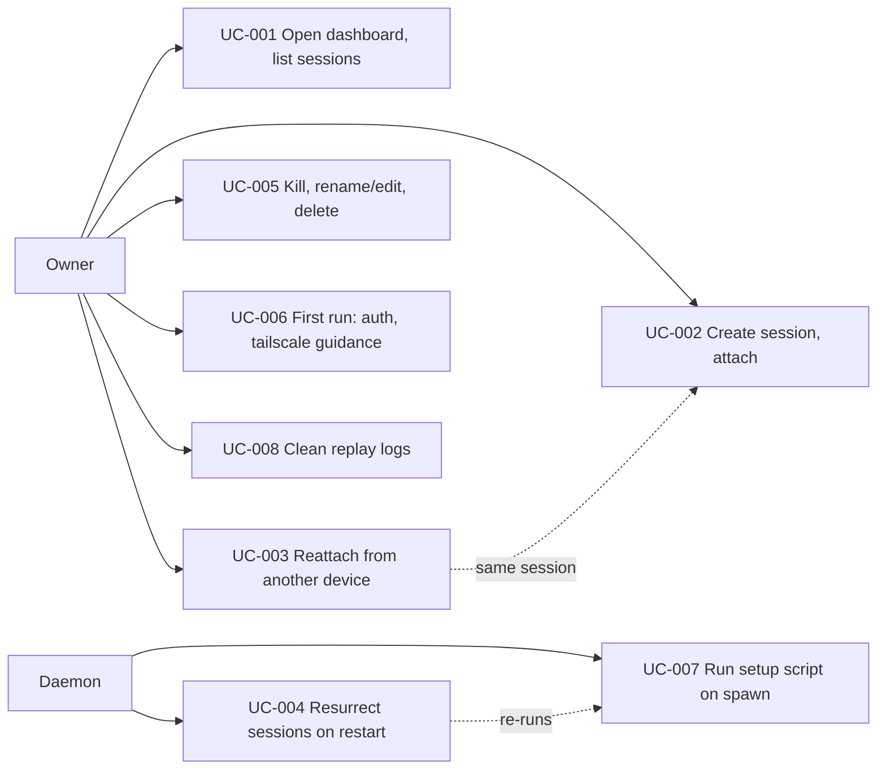

# Use Case Diagram

- Actors: Owner (single human, any browser in tailnet), Daemon (the webterm binary)
- Use cases: UC-001..UC-008 as indexed
- Relationships: reattach returns to the session created in UC-002; resurrection re-executes the UC-007 setup script
